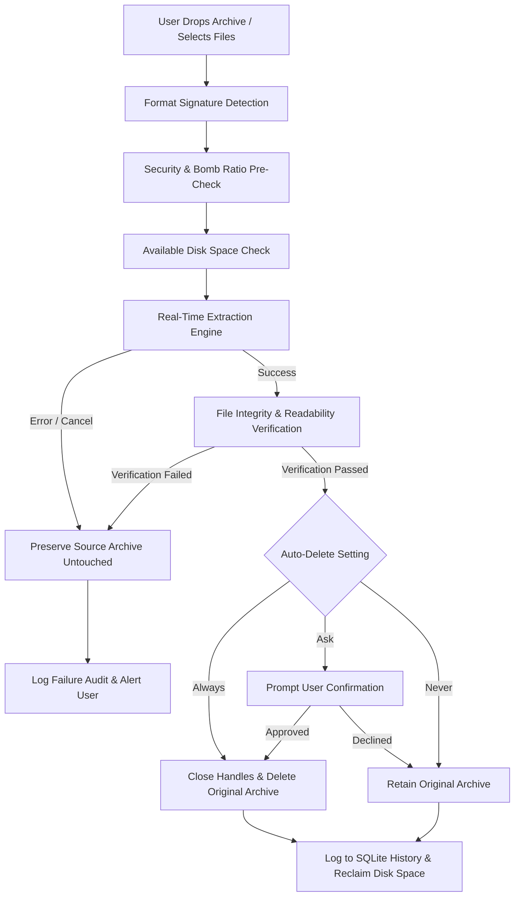

<div align="center">

# ⚡ .UnZip

### *Universal File Extraction Desktop Software with Automated Space Reclamation*

<p align="center">
  <a href="https://github.com/Kmrr-Gautam/.UnZip">
    
  </a>
</p>

[](https://github.com/Kmrr-Gautam/.UnZip/releases)
[](https://github.com/Kmrr-Gautam/.UnZip)
[](LICENSE)
[](https://github.com/Kmrr-Gautam/.UnZip)
[](https://www.electronjs.org/)

<br />

```
  ┌────────────────────────────────────────────────────────────────────────┐
  │                                                                        │
  │   📥 Drop Archive  ──▶  🔍 Extract  ──▶  🛡️ Verify  ──▶  ♻️ Auto-Clean   │
  │      Project.zip         Folder/          SHA / CRC         Deleted    │
  │                                                                        │
  └────────────────────────────────────────────────────────────────────────┘
```

<p align="center">
  <a href="#-quick-download">Quick Download</a> •
  <a href="#-features">Features</a> •
  <a href="#-supported-formats">Supported Formats</a> •
  <a href="#-safety-architecture">Safety Architecture</a> •
  <a href="#-installation--usage">Installation & Usage</a> •
  <a href="#-automated-tests">Testing</a>
</p>

---

</div>

## 💡 The Core Problem & Product Vision

Every developer and everyday user constantly downloads compressed files — `.zip`, `.rar`, `.7z`, `.tar.gz`, `.iso`. After extracting them into folders, **redundant compressed archives remain on disk**, consuming gigabytes of forgotten storage space.

**.UnZip** eliminates this friction with a unified, fail-safe workflow:
1. **Detects** archive formats using true binary signatures.
2. **Extracts** contents with high-performance real-time progress parsing.
3. **Verifies** file accessibility, entry counts, and data integrity.
4. **Reclaims space** by permanently deleting the source archive only after verification succeeds.

---

## ✨ Features at a Glance

| Feature | Description |
| :--- | :--- |
| **Universal Decompression** | Unpacks 16+ archive formats natively powered by 7-Zip & libarchive. |
| **Automated Archive Deletion** | Reclaims storage space automatically upon verified extraction. |
| **Strict Fail-Safe Rules** | **Never** deletes archives on failure, CRC mismatch, cancellation, or disk exhaustion. |
| **Zip Slip Defense** | Strict path confinement prevents directory traversal attacks (`../../`). |
| **Decompression Bomb Guard** | Detects anomalous compression ratios (>100:1) and caps oversized extractions. |
| **Persistent SQLite History** | Embedded SQLite database tracks extraction duration, destinations, and space reclaimed. |
| **Batch Concurrency Queue** | Configurable worker threads (1–8 parallel tasks) to prevent system freezing. |
| **Modern Desktop UI** | Minimalist glassmorphic dark interface with real-time speed & ETA metrics. |
| **100% Offline & Private** | Zero analytics, zero telemetries, and zero network traffic. |

---

## 🚀 Quick Download

Direct standalone binaries built for Windows 64-bit:

- 📦 **[Download Windows NSIS Installer (.exe)](release/.UnZip%20Setup%201.0.0.exe)** — *Complete setup wizard with desktop shortcuts & uninstaller (`100 MB`)*
- ⚡ **[Download Portable Executable (.exe)](release/.UnZip%201.0.0.exe)** — *Single standalone executable, run directly without installing (`100 MB`)*
- 📁 **[Download Complete Source Deliverable (.zip)](DotUnZip_Source_Deliverable.zip)** — *Clean source code bundle with tests and assets*

---

## 🛡️ Safety & Auto-Deletion Workflow



---

## 🗜️ Supported Formats Matrix

.UnZip detects file types via **binary header signatures** (magic numbers) to ensure reliable identification even when file extensions are renamed or missing.

| Format | Magic Bytes / Signature | Engine | Notes |
| :--- | :--- | :--- | :--- |
| **ZIP / ZIP64** | `50 4B 03 04` / `50 4B 05 06` | Standard / Deflate64 | Multi-volume & encrypted support |
| **RAR / RAR5** | `52 61 72 21 1A 07` | UnRAR Engine | Solid archive & multi-part sets |
| **7Z** | `37 7A BC AF 27 1C` | LZMA / LZMA2 | Ultra compression ratio |
| **TAR / TAR.GZ / TGZ** | `1F 8B` / `ustar` at 0x101 | Libarchive / Gzip | Source trees and Unix bundles |
| **BZ2 / BZIP2** | `42 5A 68` (`BZh`) | Bzip2 Engine | High-compression tarballs |
| **XZ** | `FD 37 7A 58 5A 00` | XZ Utils / LZMA2 | Linux distribution packages |
| **ZST** | `28 B5 2F FD` | Zstandard (RFC 8878) | Real-time high-speed decompression |
| **ISO** | `CD001` at 0x8000 | ISO 9660 / UDF | Disc image optical extraction |
| **CAB** | `4D 53 43 46` (`MSCF`) | Microsoft Cabinet | Windows installation cabinets |
| **WIM** | `4D 53 57 49 4D` (`MSWIM`) | Windows Imaging | System images & install packages |
| **ARJ & LZH** | `60 EA` / `-lh-` | Legacy Unpackers | DOS & retro software packages |
| **Z** | `1F 9D` | Unix Compress | LZW compressed archives |

---

## 💻 Tech Stack & Architecture

```
┌────────────────────────────────────────────────────────┐
│                   Renderer (Chromium)                  │
│       React 18  •  TypeScript  •  Tailwind CSS        │
│    Framer Motion  •  Lucide Icons  •  Glassmorphism    │
└───────────────────────────▲────────────────────────────┘
                            │ IPC Bridge (Preload.ts)
┌───────────────────────────▼────────────────────────────┐
│                    Electron Main Core                  │
│      Task Queue  •  Conflict Manager  •  Settings      │
├────────────────────────────────────────────────────────┤
│                    Extraction Engine                   │
│      7-Zip Stream Runner  •  Magic Byte Sniffer        │
├────────────────────────────────────────────────────────┤
│                    Security Guard                      │
│     Zip Slip Confinement  •  Decompression Bomb Shield │
├────────────────────────────────────────────────────────┤
│                 SQLite Local Database                  │
│      sql.js WebAssembly  •  Binary Disk Persistence    │
└────────────────────────────────────────────────────────┘
```

---

## 🔧 Installation & Development

### Clone & Install
```bash
git clone https://github.com/Kmrr-Gautam/.UnZip.git
cd .UnZip
npm install
```

### Run in Development
```bash
npm run dev    # Starts Vite dev server
npm start      # Launches Electron window
```

### Run Automated Tests
```bash
npm test
```

### Compile & Build Installer
```bash
npm run build  # Builds React renderer & Main TypeScript
npm run dist   # Produces NSIS Installer & Portable .exe in release/
```

---

## 🧪 Automated Test Suite (29/29 Passing)

The test suite covers full end-to-end extraction safety:

```bash
 ✓ tests/format-detector.test.ts (11 tests)
   - Standard ZIP, Empty ZIP, 7Z, RAR4, RAR5, GZ, TAR.GZ, TGZ, BZ2, XZ, ZST, CAB, WIM, Multi-part
 ✓ tests/security.test.ts (6 tests)
   - Relative path confinement, Zip Slip directory traversal blocked, Windows DOS devices sanitized
   - Decompression bomb ratio detection (>100:1), maximum safe size limit (50 GB)
 ✓ tests/verification.test.ts (3 tests)
   - File accessibility verification, missing folder detection, missing expected files detection
 ✓ tests/auto-delete.test.ts (5 tests)
   - Safe deletion on success, archive preservation on failure, cancel preservation, atomic multi-part cleanup
 ✓ tests/history-persistence.test.ts (2 tests)
   - SQLite table creation, record insertion, restart survival across SQLite database reload
 ✓ tests/real-extraction.test.ts (2 tests)
   - Real archive creation with Unicode & nested subdirectories, SHA-256 validation, verified deletion
   - Corrupted archive failure preservation test
```

---

## 🔒 Security Assurances

1. **Zero Path Escaping**: Strict `path.resolve` validation guarantees no archive entry writes outside its designated destination.
2. **Safe Handle Closure**: File descriptor handles are closed before deletion attempts to avoid OS `EBUSY` locks.
3. **No Forensic False Claims**: Deletions use the standard OS file system deletion API.
4. **Local Execution**: All processes execute locally on your hardware.

---

## 📄 License

This project is licensed under the **MIT License** — feel free to use, modify, and distribute.

Crafted with precision for **[github.com/Kmrr-Gautam](https://github.com/Kmrr-Gautam)**.
